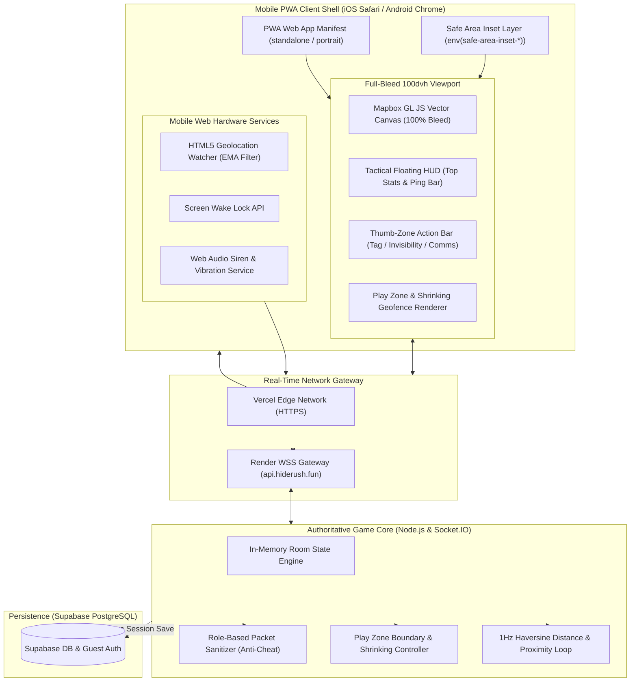
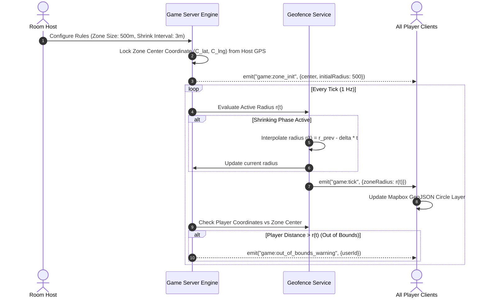
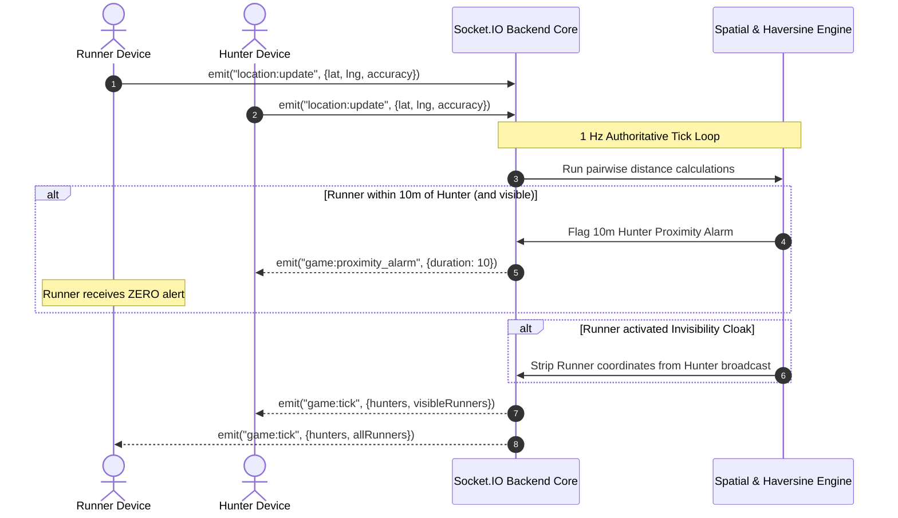

# ARCHITECTURE.md — HIDERUSH System & Mobile Game Architecture

> **Document Version:** 1.1.0  
> **Target System:** Mobile-First Real-Time Location Game (PWA / Mobile Browser)  
> **Status:** APPROVED SYSTEM ARCHITECTURE  

---

## 1. High-Level Architecture Overview

HIDERUSH is architected as an **immersive mobile web game** rather than a traditional desktop site. The client shell is built using Next.js 14+ (App Router) configured as a full-bleed Progressive Web App (PWA) with zero browser chrome, running atop a high-performance Node.js + Express + Socket.IO state and spatial calculation server.



---

## 2. Mobile Gaming Client Architecture (Next.js PWA Shell)

### 2.1 Viewport Configuration & Safe Areas
To ensure a native gaming feel and avoid browser UI collision, the application shell implements:
- **Viewport Meta:**
  ```html
  <meta name="viewport" content="width=device-width, initial-scale=1.0, maximum-scale=1.0, user-scalable=no, viewport-fit=cover" />
  ```
- **CSS Safe-Area Rules:**
  ```css
  :root {
    --sat: env(safe-area-inset-top);
    --sab: env(safe-area-inset-bottom);
    --sal: env(safe-area-inset-left);
    --sar: env(safe-area-inset-right);
  }
  
  /* Disable elastic overscroll bounce and touch text selection */
  html, body {
    width: 100vw;
    height: 100dvh;
    overflow: hidden;
    touch-action: manipulation;
    user-select: none;
    -webkit-user-select: none;
    background-color: #07090E;
  }
  ```

### 2.2 Layered Viewport Stacking
The mobile screen layout is composed of three strictly isolated z-index planes:

1. **Layer 0 (Base, $z = 0$): Full-Bleed Mapbox Canvas**
   - Occupies `100vw \times 100dvh`.
   - Renders GeoJSON vector tiles, player coordinate markers with smooth linear interpolation (lerp), and geofence boundary rings.
2. **Layer 1 (Middle, $z = 10$): Floating Tactical HUD Panels**
   - **Top Bar:** Floating rounded pill with backdrop-blur (`bg-neutral-900/80 border border-neutral-800 rounded-2xl`) housing remaining time, active runners count, and ping sweep indicator.
   - **Floating Indicators:** Radar ping sweep circle, zone shrinking alerts, and proximity warning banners.
3. **Layer 2 (Top, $z = 20$): Thumb-Zone Action Bar**
   - Positioned at the bottom of the screen with `margin-bottom: max(16px, env(safe-area-inset-bottom))`.
   - Hosts high-priority game actions: **"TAG RUNNER"** (Hunter) or **"INVISIBILITY CLOAK"** (Runner) and Quick Comms/Radio button.
   - Guaranteed minimum touch target of $56\text{px}$ height for effortless reach by the user's thumb while moving.

---

## 3. Play Zone (Geofence) & Shrinking Ring Architecture

To support the house rules presets (**Quick**, **Standard**, **Big Park**), the game server and client coordinate a dynamic circular geofence boundary:



---

## 4. Location Synchronization & Asymmetric Packet Filtering

The 1Hz spatial game loop sanitizes outgoing packets based on role and active abilities:



---

## 5. Client State Management Architecture (Zustand)

Client state is segregated into decoupled stores to isolate UI rendering from high-frequency sensor ticks:

```
┌─────────────────────────────────────────────────────────────┐
│                      Client State Stores                    │
├──────────────────────────────┬──────────────────────────────┤
│ `useSessionStore`            │ `useGameStore`               │
│ - Guest UUID & JWT           │ - Match Phase (LOBBY/ACTIVE) │
│ - Callsign & Avatar          │ - Game Timer & Ping Clock    │
│ - Socket connection status   │ - Role (HUNTER / RUNNER)     │
│                              │ - Remaining Runners count    │
├──────────────────────────────┼──────────────────────────────┤
│ `useGeoStore` (Throttled)    │ `useMechanicsStore`          │
│ - Local GPS lat, lng, acc    │ - Proximity Alarm (Active)   │
│ - Device Heading (Compass)   │ - Invisibility Cooldown (s)  │
│ - Signal Health (Green/Red)  │ - Catch Availability (Bool)  │
└──────────────────────────────┴──────────────────────────────┘
```

---

## 6. Hardware Web API Integration Architecture

1. **Screen Wake Lock API (`useWakeLock`):**
   - Automatically requests `navigator.wakeLock.request('screen')` on mounting the Lobby or Game screen.
   - Binds to `document.addEventListener('visibilitychange')` to immediately re-acquire lock when switching back from notification shade or another app.
2. **Web Audio Siren (`AudioService`):**
   - Instantiates a persistent `AudioContext` on the first user tap on the Home screen ("Host" or "Join").
   - Generates dual-tone synthetic square-wave alarm bursts on demand, avoiding audio loading latency or autoplay policy blocks.
3. **Vibration Feedback (`VibrationService`):**
   - Dispatches `navigator.vibrate([300, 200, 300, 200, 300])` for tactical haptics on Android Chrome (graceful no-op on iOS Safari).
