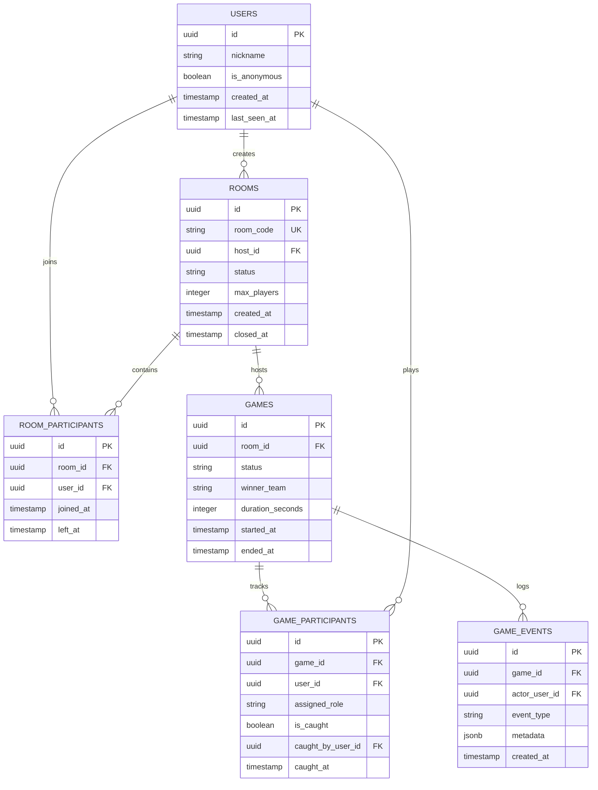

# DATABASE_SCHEMA.md — Supabase PostgreSQL Architecture

> **Database Engine:** PostgreSQL 15+ (Hosted via Supabase)  
> **Schema Version:** 1.0.0  
> **Status:** APPROVED PRODUCTION SCHEMA  

---

## 1. Architectural Philosophy: In-Memory vs. Persistent State

To deliver sub-second latency and prevent database I/O bottlenecks during active matches, **real-time high-frequency data (such as 1Hz GPS coordinate streams, live countdown seconds, and proximity alarm states) lives entirely in Node.js server RAM**.

The PostgreSQL database on Supabase is reserved exclusively for:
1. **Identity & Session Management:** Guest user sessions and registered accounts.
2. **Room Audit Records:** Room creation, lifetime, and host assignment.
3. **Completed Game Records:** Match results, win/loss history, and performance stats.
4. **Audit Logs & Security Telemetry:** Event logs for catches, ability usage, and disconnects.

---

## 2. Entity-Relationship Diagram (ERD)



---

## 3. Detailed Table Definitions & SQL DDL

### 3.1 `users`
Stores player profiles (both guest/anonymous users and registered accounts).
```sql
CREATE TABLE public.users (
    id UUID PRIMARY KEY DEFAULT gen_random_uuid(),
    nickname VARCHAR(32) NOT NULL,
    is_anonymous BOOLEAN NOT NULL DEFAULT true,
    created_at TIMESTAMPTZ NOT NULL DEFAULT timezone('utc'::text, now()),
    last_seen_at TIMESTAMPTZ NOT NULL DEFAULT timezone('utc'::text, now())
);

CREATE INDEX idx_users_last_seen ON public.users(last_seen_at);
```

### 3.2 `rooms`
Stores private multiplayer room containers.
```sql
CREATE TYPE room_status AS ENUM ('OPEN', 'ACTIVE', 'CLOSED');

CREATE TABLE public.rooms (
    id UUID PRIMARY KEY DEFAULT gen_random_uuid(),
    room_code VARCHAR(6) NOT NULL UNIQUE,
    host_id UUID NOT NULL REFERENCES public.users(id) ON DELETE CASCADE,
    status room_status NOT NULL DEFAULT 'OPEN',
    max_players SMALLINT NOT NULL DEFAULT 15 CHECK (max_players <= 15),
    created_at TIMESTAMPTZ NOT NULL DEFAULT timezone('utc'::text, now()),
    closed_at TIMESTAMPTZ
);

CREATE INDEX idx_rooms_code_status ON public.rooms(room_code, status);
```

### 3.3 `room_participants`
Junction table tracking player entries and exits in a room lobby.
```sql
CREATE TABLE public.room_participants (
    id UUID PRIMARY KEY DEFAULT gen_random_uuid(),
    room_id UUID NOT NULL REFERENCES public.rooms(id) ON DELETE CASCADE,
    user_id UUID NOT NULL REFERENCES public.users(id) ON DELETE CASCADE,
    joined_at TIMESTAMPTZ NOT NULL DEFAULT timezone('utc'::text, now()),
    left_at TIMESTAMPTZ,
    CONSTRAINT unique_active_room_participant UNIQUE (room_id, user_id)
);

CREATE INDEX idx_room_participants_user ON public.room_participants(user_id);
```

### 3.4 `games`
Records individual matches executed within a room.
```sql
CREATE TYPE game_status AS ENUM ('COUNTDOWN', 'IN_PROGRESS', 'COMPLETED', 'ABORTED');
CREATE TYPE team_type AS ENUM ('HUNTERS', 'HIDERS', 'NONE');

CREATE TABLE public.games (
    id UUID PRIMARY KEY DEFAULT gen_random_uuid(),
    room_id UUID NOT NULL REFERENCES public.rooms(id) ON DELETE CASCADE,
    status game_status NOT NULL DEFAULT 'COUNTDOWN',
    winner_team team_type NOT NULL DEFAULT 'NONE',
    duration_seconds INTEGER NOT NULL DEFAULT 600,
    started_at TIMESTAMPTZ NOT NULL DEFAULT timezone('utc'::text, now()),
    ended_at TIMESTAMPTZ
);

CREATE INDEX idx_games_room_id ON public.games(room_id);
```

### 3.5 `game_participants`
Tracks role assignment and final survival outcome per player per game.
```sql
CREATE TYPE player_role AS ENUM ('HUNTER', 'HIDER', 'SPECTATOR');

CREATE TABLE public.game_participants (
    id UUID PRIMARY KEY DEFAULT gen_random_uuid(),
    game_id UUID NOT NULL REFERENCES public.games(id) ON DELETE CASCADE,
    user_id UUID NOT NULL REFERENCES public.users(id) ON DELETE CASCADE,
    assigned_role player_role NOT NULL,
    is_caught BOOLEAN NOT NULL DEFAULT false,
    caught_by_user_id UUID REFERENCES public.users(id),
    caught_at TIMESTAMPTZ,
    CONSTRAINT unique_game_player UNIQUE (game_id, user_id)
);

CREATE INDEX idx_game_participants_game ON public.game_participants(game_id);
```

### 3.6 `game_events`
Audit log of critical in-game actions for telemetry, replay analysis, and anti-cheat verification.
```sql
CREATE TABLE public.game_events (
    id UUID PRIMARY KEY DEFAULT gen_random_uuid(),
    game_id UUID NOT NULL REFERENCES public.games(id) ON DELETE CASCADE,
    actor_user_id UUID REFERENCES public.users(id),
    event_type VARCHAR(64) NOT NULL, -- 'INVISIBILITY_TRIGGERED', 'CATCH_VALIDATED', 'ALARM_FIRED'
    metadata JSONB DEFAULT '{}'::jsonb,
    created_at TIMESTAMPTZ NOT NULL DEFAULT timezone('utc'::text, now())
);

CREATE INDEX idx_game_events_game_type ON public.game_events(game_id, event_type);
```

---

## 4. Row Level Security (RLS) Policies

All tables in the `public` schema have Row Level Security enabled to prevent unauthorized direct client access.

```sql
-- Enable RLS across all tables
ALTER TABLE public.users ENABLE ROW LEVEL SECURITY;
ALTER TABLE public.rooms ENABLE ROW LEVEL SECURITY;
ALTER TABLE public.room_participants ENABLE ROW LEVEL SECURITY;
ALTER TABLE public.games ENABLE ROW LEVEL SECURITY;
ALTER TABLE public.game_participants ENABLE ROW LEVEL SECURITY;
ALTER TABLE public.game_events ENABLE ROW LEVEL SECURITY;

-- Service Role (Backend Node.js server) bypasses RLS
-- Client reads are restricted to public room lookups and personal user profiles
CREATE POLICY "Public can view open rooms"
ON public.rooms FOR SELECT
USING (status = 'OPEN');

CREATE POLICY "Users can view their own profile"
ON public.users FOR SELECT
USING (auth.uid() = id OR is_anonymous = true);

CREATE POLICY "Participants can view game summary"
ON public.games FOR SELECT
USING (true);
```

---

## 5. Persistent vs. In-Memory State Mapping

| Feature | In-Memory (Node.js RAM) | Persistent (Supabase DB) |
| :--- | :---: | :---: |
| Live GPS Coordinates (lat, lng, heading) | ✅ (1 Hz buffer) | ❌ (Never saved to DB) |
| Live Pairwise Distance Calculations | ✅ (RAM matrix) | ❌ |
| Active Proximity Alarm Status | ✅ (RAM state) | ❌ |
| 15-Second Invisibility Countdown | ✅ (Active timer) | ❌ |
| 3-Minute Ability Cooldown Timestamp | ✅ (Active memory) | ❌ |
| Match Elimination Events | ✅ (Instant dispatch) | ✅ (Logged on event) |
| Room Metadata & Host ID | ✅ (Active room) | ✅ (Persisted row) |
| Final Game Outcome & Duration | ✅ (Match end) | ✅ (Permanent record) |

